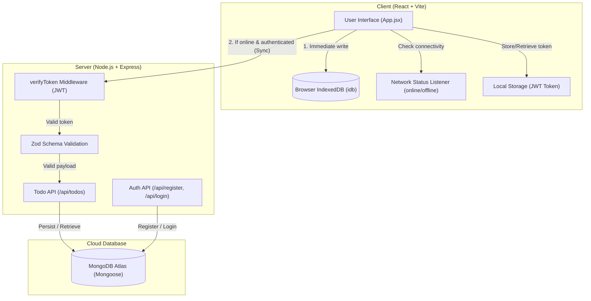

# Fullstack Offline-First Todo Application

A modern, full-stack, offline-first Todo application built with **React (Vite)** on the frontend and **Node.js (Express) + MongoDB** on the backend. It features seamless client-side persistence with **IndexedDB**, real-time online/offline network detection, user authentication via **JWT** and **bcrypt**, and input validation using **Zod**.

---

## Architecture & System Design

The application follows an **Offline-First Architecture**. User actions (like creating and browsing todos) are captured locally in the browser's IndexedDB first, ensuring zero latency and uncompromised usability even when the user is disconnected from the network. Once the user is connected and authenticated, todos are synced to the cloud MongoDB database.

### System Flow Diagram



---

## Key Functionality & Features

1. **Offline-First Persistence**:
   - Todos are written immediately to IndexedDB via the `idb` library.
   - If the network drops or the server is unreachable, the application continues to operate without loss of user input.

2. **Reactive Online / Offline Detection**:
   - Listens to browser `online` and `offline` events.
   - Visual status indicators show connection health (`🟢 Online` vs `🔴 Offline`) and sync states (`☁️ Synced` vs `💾 Local Only`).

3. **Secure Authentication**:
   - Passwords are encrypted using `bcrypt` (salt rounds: 10) prior to persistence.
   - Stateless authentication using JSON Web Tokens (`jsonwebtoken`) with an expiration policy (1 hour).
   - Protected API routes enforce authentication via custom Express middleware (`verifyToken`).

4. **Schema & Input Validation**:
   - Strict payload validation on API inputs using `zod` (`min(1)` character length requirement, optional completion boolean).
   - Mongoose data modeling with relational references between users and their owned todos.

5. **Hardened Security & Secret Management**:
   - Database connection strings, server port configurations, and JWT secrets are managed via `dotenv`.
   - Sensitive `.env` files are excluded from version control via `.gitignore`.

---

## Project Structure

```
fullstack-offline-todo/
├── .gitignore                     # Root gitignore protecting secrets and node_modules
├── README.md                      # Complete project documentation and design
├── client/                        # Frontend React + Vite application
│   ├── .gitignore                 # Client-specific gitignore
│   ├── package.json               # Client dependencies (react, idb, vite, etc.)
│   ├── vite.config.js             # Vite development server configuration
│   └── src/
│       ├── App.jsx                # Main application UI, auth logic, and sync handlers
│       ├── db.js                  # IndexedDB database initializers and helpers
│       ├── main.jsx               # React entry point
│       └── App.css                # Application styles
└── server/                        # Backend Node.js + Express application
    ├── .env                       # Sensitive environment variables (Ignored by Git)
    ├── .env.example               # Template environment configuration for developers
    ├── .gitignore                 # Server-specific gitignore protecting .env
    ├── package.json               # Server dependencies (express, mongoose, jwt, zod, etc.)
    ├── index.js                   # Express server entry point & route definitions
    ├── middleware.js              # JWT verification middleware
    ├── Todo.js                    # Mongoose Todo schema & model
    ├── todoSchema.js              # Mongoose User schema & model
    └── todoValidator.js           # Zod validation schema for incoming todo payloads
```

---

## Environment Configuration

The server expects configuration parameters to be supplied via environment variables.

### 1. Create Server `.env` File
In the `server` directory, create a `.env` file (or copy from `.env.example`):

```bash
# In server directory
PORT=5000
MONGODB_URI=your_mongodb_connection_string_here
JWT_SECRET=your_secure_jwt_secret_here
```

### 2. Available Environment Variables

| Variable | Description | Default / Example |
| :--- | :--- | :--- |
| `PORT` | Port number on which the Express server listens | `5000` |
| `MONGODB_URI` | MongoDB Atlas / local connection string | `mongodb+srv://...` |
| `JWT_SECRET` | Secret key used to sign and verify JWT tokens | `your-super-secret-key` |

> [!IMPORTANT]
> Never commit `.env` to Git. Ensure `.env` is listed in `server/.gitignore` and `.gitignore` at the root.

---

## Getting Started

### Prerequisites
- [Node.js](https://nodejs.org/) (v18 or higher recommended)
- [MongoDB Atlas](https://www.mongodb.com/cloud/atlas) account or a local MongoDB instance

---

### Step 1: Start the Backend Server

```bash
# Navigate to the server folder
cd server

# Install dependencies
npm install

# Configure environment variables
# Ensure your .env file is present with valid credentials

# Start the server
node index.js
```

Server output upon success:
```
Server running on port 5000
Connected to MongoDB
```

---

### Step 2: Start the Frontend Client

In a separate terminal:

```bash
# Navigate to the client folder
cd client

# Install dependencies
npm install

# Start the Vite development server
npm run dev
```

Open your browser and navigate to the local Vite URL (typically `http://localhost:5173`).

---

## API Reference

### 1. User Registration
- **Endpoint**: `POST /api/register`
- **Request Body**:
  ```json
  {
    "username": "johndoe",
    "password": "securepassword123"
  }
  ```
- **Response**: `201 Created`
  ```json
  {
    "message": "User created successfully",
    "userId": "6724..."
  }
  ```

---

### 2. User Login
- **Endpoint**: `POST /api/login`
- **Request Body**:
  ```json
  {
    "username": "johndoe",
    "password": "securepassword123"
  }
  ```
- **Response**: `200 OK`
  ```json
  {
    "message": "Login successful",
    "token": "eyJhbGciOi...",
    "userId": "6724..."
  }
  ```

---

### 3. Get User Todos
- **Endpoint**: `GET /api/todos`
- **Headers**:
  ```http
  Authorization: Bearer <JWT_TOKEN>
  ```
- **Response**: `200 OK`
  ```json
  [
    {
      "_id": "6724...",
      "userId": "6724...",
      "text": "Buy groceries",
      "completed": false,
      "createdAt": "2026-11-06T17:30:00.000Z"
    }
  ]
  ```

---

### 4. Create Todo
- **Endpoint**: `POST /api/todos`
- **Headers**:
  ```http
  Authorization: Bearer <JWT_TOKEN>
  Content-Type: application/json
  ```
- **Request Body**:
  ```json
  {
    "text": "Complete project documentation"
  }
  ```
- **Response**: `201 Created`
  ```json
  {
    "_id": "6725...",
    "userId": "6724...",
    "text": "Complete project documentation",
    "completed": false,
    "createdAt": "2026-11-06T17:35:00.000Z"
  }
  ```

---

## License

ISC
